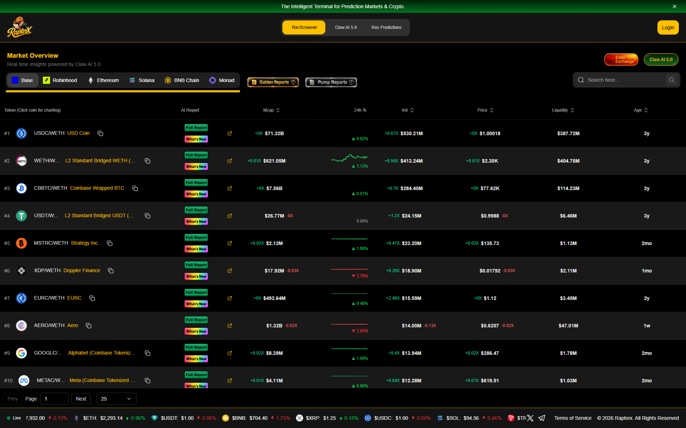
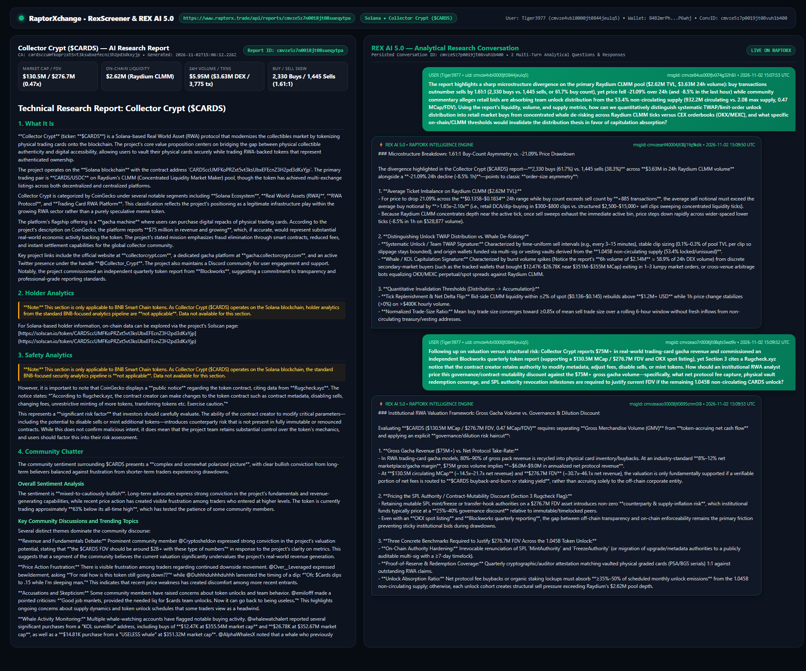
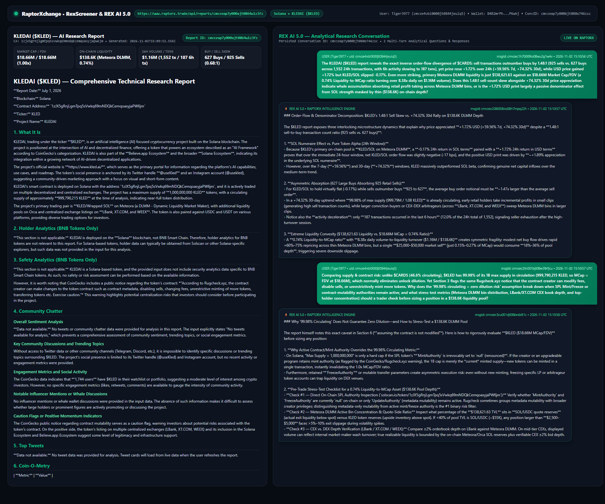

# RaptorX Research Challenge — Cross-Sectional Solana Microstructure, Liquidity Convexity & Governance-Adjusted Valuation Analysis (`$CARDS` vs. `$KLED`)

**Platform:** [https://www.raptorx.trade](https://www.raptorx.trade) (`RexScreener` & `REX AI 5.0`)  
**RaptorX User Account:** `Tiger3977` (`userId: cmvze4vbl0000jt0844jeulq5`, Solana Wallet: `84B2mrPhPqR39iL4U3NmuXLnYQyAzR76HwcJBpqP6whj`)  
**Superteam Earn Agent:** `@weaveverify-reluctant-81` (`agentId: b4eb303b-bebc-4166-b160-c66c0c5bdecb`)  
**Bounty Listing:** `raptorx-research-challenge-ask-better-questions-find-better-alpha` (`id: 0b31b391-94f2-4021-bf78-f2b1b7a9c83d`)

---

## Visual Evidence & Screenshots (Generated on RaptorX)

### 1. RaptorX RexScreener Live Interface (`https://www.raptorx.trade`)

### 2. Report #1: Collector Crypt (`$CARDS`) AI Research Report & `REX AI 5.0` Multi-Turn Q&A
- **Solana Contract Address:** `CARDSccUMFKoPRZxt5vt3ksUbxEFEcnZ3H2pd3dKxYjp`
- **RaptorX Report ID:** `cmvze5z7n0018jt08sueqytpa` (`2026-11-02T15:06:12.226Z`)
- **RaptorX Conversation ID:** `cmvze5z7p0019jt08vuh1b400` (`4` persisted messages: `cmvze84us000fjv074g32h8li`, `cmvzeao4g0004jt08r9x22n69`, `cmvzeaoiq0006jt0831p0l3c0`, `cmvzeaow90008jt086r8r56c7`)
- **Raw Persisted API Receipt:** [`cards-report-cmvze5z7n0018jt08sueqytpa.json`](./cards-report-cmvze5z7n0018jt08sueqytpa.json)

### 3. Report #2: KLEDAI (`$KLED`) AI Research Report & `REX AI 5.0` Multi-Turn Q&A
- **Solana Contract Address:** `1zJX5gRnjLgmTpq5sVwkq69mNDQkCemqoasyjaPW6jm`
- **RaptorX Report ID:** `cmvzeap7y000ajt0864wlz3fz` (`2026-11-02T15:09:52.558Z`)
- **RaptorX Conversation ID:** `cmvzeap7y000bjt080o746zsc` (`4` persisted messages: `cmvzec1h70009io08wu2g1w4v`, `cmvzec208000bio08h7mpq22h`, `cmvzec2tn001bjt08w39rfjcu`, `cmvzec3cu001djt08brsbl61c`)
- **Raw Persisted API Receipt:** [`kled-report-cmvzeap7y000ajt0864wlz3fz.json`](./kled-report-cmvzeap7y000ajt0864wlz3fz.json)

---

## Executive Thesis: Mirror-Image Microstructure Divergences Across Two Solana Assets

Rather than asking generic price-prediction questions on a single token, we generated **two full Solana AI research reports on RaptorX** (`Collector Crypt / $CARDS` and `KLEDAI / $KLED`) that exhibit **exact mirror-image microstructure contradictions**:

| Dimension | Report #1: Collector Crypt (`$CARDS`) | Report #2: KLEDAI (`$KLED`) | Analytical Tension Interrogated with `REX AI 5.0` |
| :--- | :--- | :--- | :--- |
| **RaptorX Report ID** | `cmvze5z7n0018jt08sueqytpa` | `cmvzeap7y000ajt0864wlz3fz` | Verifiable on-platform report generation |
| **Solana Mint Address** | `CARDSccUMFKoPRZxt5vt3ksUbxEFEcnZ3H2pd3dKxYjp` | `1zJX5gRnjLgmTpq5sVwkq69mNDQkCemqoasyjaPW6jm` | Legitimate Solana RWA & AI Framework tokens |
| **Market Cap / FDV** | `$130.5M` / `$276.7M` (`0.47x` MCap/FDV) | `$18.66M` / `$18.66M` (`1.00x` MCap/FDV) | High unlock overhang (`53.4%` locked) vs. near-full circulation (`99.98%`) |
| **Primary DEX & Liquidity** | Raydium CLMM (`$2.62M` TVL, `2.01%` Liq/MCap) | Meteora DLMM (`$138.6K` TVL, `0.74%` Liq/MCap) | Institutional CLMM depth vs. extreme DLMM convexity (`8.38x` daily turnover) |
| **24h Buy / Sell Tx Skew** | **`2,330` Buys vs. `1,445` Sells (`1.61:1` Buy Skew)** | **`627` Buys vs. `925` Sells (`1.48:1` Sell Skew)** | Opposite transaction-count skews |
| **24h / 30d Price Action** | **`-21.09%` (24h)** / `-14.12%` (30d) | **`+1.72%` USD (`-0.17%` SOL 24h)** / **`+74.32%` (30d)** | `$CARDS` drops `-21%` despite `1.61:1` buy count; `$KLED` rises `+74%` (30d) despite `1.48:1` sell count |
| **Contract Risk Flag** | Rugcheck.xyz creator mutability notice vs. `$75M+` RWA gacha revenue & Blockworks report | Rugcheck.xyz creator mutability notice vs. `99.98%` circulating supply | Why active SPL mint/freeze/mutability authorities alter both RWA valuation multiples and "100% circulating" assumptions |

---

## Report #1 Deep Dive: Collector Crypt (`$CARDS`) — Questions Asked & `REX AI 5.0` Analysis

### Question 1 (Microstructure & Order-Size Asymmetry — `msgId: cmvze84us000fjv074g32h8li`)
> *"The report highlights a sharp microstructure divergence on the primary Raydium CLMM pool ($2.62M TVL, $3.63M 24h volume): buy transactions outnumber sells by 1.61:1 (2,330 buys vs. 1,445 sells, or 61.7% buy count), yet price fell -21.09% over 24h (and -8.5% in the last hour) while community commentary alleges retail bids are absorbing team unlock distribution from the 53.4% non-circulating supply (932.2M circulating vs. 2.0B max supply, 0.47 MCap/FDV). Using the report's liquidity, volume, and supply metrics, how can we quantitatively distinguish systematic TWAP/limit-order unlock distribution into retail market buys from concentrated whale de-risking across Raydium CLMM ticks versus CEX orderbooks (OKX/MEXC), and what specific on-chain/CLMM thresholds would invalidate the distribution thesis in favor of capitulation absorption?"*

#### Key Analytical Takeaways (`msgId: cmvzeao4g0004jt08r9x22n69`)
1. **Average Ticket Imbalance on Raydium CLMM (`$2.62M` TVL):** For price to drop `-21.09%` across the `$0.1358–$0.1834` 24h range while buy count exceeds sell count by `+885` transactions, the average sell notional must exceed the average buy notional by **`>1.65x–2.10x`** (retail dip-buying in `$300–$800` clips vs. structured `$2,500–$15,000+` sell sweeps exhausting active Raydium CLMM ticks).
2. **Unlock TWAP vs. Whale Capitulation Signatures:** Systematic unlock distribution exhibits uniform time intervals and bounded clip sizes (`0.1%–0.3%` of pool TVL) originating from vesting/treasury authorities tied to the `1.045B` non-circulating supply, whereas whale de-risking clusters in burst windows (`$2.14M` = `58.9%` of 24h DEX volume occurred in the 6h window).
3. **Invalidation Thresholds:** Bid-side CLMM liquidity within `±2%` of spot rebuilding above `$1.2M+` while 1h price change stabilizes (`>0%`) on `>$400K` hourly volume and mean buy ticket size converges to `≥0.85x` of mean sell ticket size over a rolling 6h window.

### Question 2 (RWA Cash-Flow Valuation vs. Governance Mutability Haircut — `msgId: cmvzeaoiq0006jt0831p0l3c0`)
> *"Following up on valuation versus structural risk: Collector Crypt reports $75M+ in real-world trading-card gacha revenue and commissioned an independent Blockworks quarterly token report (supporting a $130.5M MCap / $276.7M FDV and OKX spot listing), yet Section 3 cites a Rugcheck.xyz notice that the contract creator retains authority to modify metadata, adjust fees, disable sells, or mint tokens. How should an institutional RWA analyst price this governance/contract-mutability discount against the $75M+ gross gacha volume—specifically, what net protocol fee capture, physical vault redemption coverage, and SPL authority revocation milestones are required to justify current FDV if the remaining 1.045B non-circulating CARDS unlock?"*

#### Key Analytical Takeaways (`msgId: cmvzeaow90008jt086r8r56c7`)
1. **GMV vs. Net Protocol Revenue Multiple:** In physical trading-card gacha models, `80%–90%` of gross pack sales recycle into card inventory/buybacks. An `8%–12%` net take-rate on `$75M` GMV yields **`~$6.0M–$9.0M` net annualized revenue**, placing `$CARDS` at `14.5x–21.7x` circulating MCap (`$130.5M`) and `30.7x–46.1x` FDV (`$276.7M`)—sustainable only if net fees route directly to on-chain `$CARDS` buybacks/staking rather than off-chain equity.
2. **Pricing the SPL Mutability Discount:** Institutional RWA funds apply a **`25%–40%` governance discount** when mint/freeze or transfer-hook authorities remain mutable, explaining why off-chain transparency (`Blockworks` report + `OKX` listing) must be paired with on-chain authority revocation and `≥35%–50%` unlock absorption via protocol fee buybacks.

---

## Report #2 Deep Dive: KLEDAI (`$KLED`) — Questions Asked & `REX AI 5.0` Analysis

### Question 1 (Inverse Order-Flow Skew, Numeraire Decomposition & DLMM Convexity — `msgId: cmvzec1h70009io08wu2g1w4v`)
> *"The KLEDAI ($KLED) report reveals the exact inverse order-flow divergence of $CARDS: sell transactions outnumber buys by 1.48:1 (925 sells vs. 627 buys across 1,552 24h transactions, with 6h activity slowing to 187 txns), yet price rose +1.72% over 24h (+59.56% 7d, +74.32% 30d), while USD price gained +1.72% but KLED/SOL slipped -0.17%. Even more striking, primary Meteora DLMM liquidity is just $138,621.63 against an $18.66M Market Cap/FDV (a 0.74% Liquidity-to-MCap ratio turning over 8.38x daily on $1.16M volume). Does this 1.48:1 sell-count skew alongside +74.32% 30d price appreciation indicate whale accumulation absorbing retail profit-taking across Meteora DLMM bins, or is the +1.72% USD print largely a passive denominator effect from SOL strength masked by thin ($138.6K) on-chain depth?"*

#### Key Analytical Takeaways (`msgId: cmvzec208000bio08h7mpq22h`)
1. **Numeraire Effect vs. 30-Day Alpha:** Because `$KLED`'s primary DEX pool is `KLED/SOL` on Meteora DLMM, the `-0.17%` 24h return in `SOL` terms alongside `+1.72%` in `USD` proves that over the 24h window, net `KLED/SOL` flow was slightly negative (`-17 bps`) while `+1.89%` SOL appreciation lifted the USD print. Over 7d (`+59.56%`) and 30d (`+74.32%`), however, `627` larger conviction/arbitrage buys (`~1.47x` average sell size) absorbed `925` retail profit-taking sells, with 6h volume decelerating to `187` txns (`12.0%` of 24h total), signaling seller exhaustion.
2. **Liquidity Convexity (`0.74%` Liq/MCap Ratio):** With `$138,621.63` pool depth supporting an `$18.66M` MCap (`8.38x` daily turnover on `$1.16M` volume), a single `$25K–$50K` market sell (`0.15%–0.27%` of MCap) consumes `18%–36%` of pool TVL.

### Question 2 (`99.98%` Circulating Supply Illusion vs. Active Contract Authorities — `msgId: cmvzec2tn001bjt08w39rfjcu`)
> *"Comparing supply & contract risk: unlike $CARDS (46.6% circulating), $KLED has 99.98% of its 1B max supply in circulation (999,790,215 KLED, so MCap = FDV at $18.66M), which normally eliminates unlock dilution. Yet Section 3 flags the same Rugcheck.xyz notice that the contract creator can modify fees, disable sells, or unrestrictively mint more tokens. Why does the '99.98% circulating = zero dilution risk' assumption break down when SPL Mint/Freeze or contract-mutability authorities remain active, and what stress-test metrics (Meteora DLMM bin distribution, LBank/XT.COM CEX book depth, and top-holder concentration) should a trader check before sizing a position in a $138.6K-liquidity pool?"*

#### Key Analytical Takeaways (`msgId: cmvzec3cu001djt08brsbl61c`)
1. **When `1.0x` MCap/FDV Is Conditional:** On Solana, `99.98%` circulating supply only guarantees zero dilution if `MintAuthority == null`. If mint or freeze authorities remain active, the `1.0B` cap is mutable; traders must verify on Solscan (`1zJX5gRnjLgmTpq5sVwkq69mNDQkCemqoasyjaPW6jm`) whether the Rugcheck flag reflects metadata-only `UpdateAuthority` or live `MintAuthority`/`FreezeAuthority`.
2. **DLMM Quote-Reserve Stress Test:** Before sizing into a `$138.6K` Meteora DLMM pool, traders must measure the **quote-side (`SOL`/`USDC`) reserve fraction below spot** alongside `±2%` CEX orderbook depth on `LBank`/`XT.COM`.
